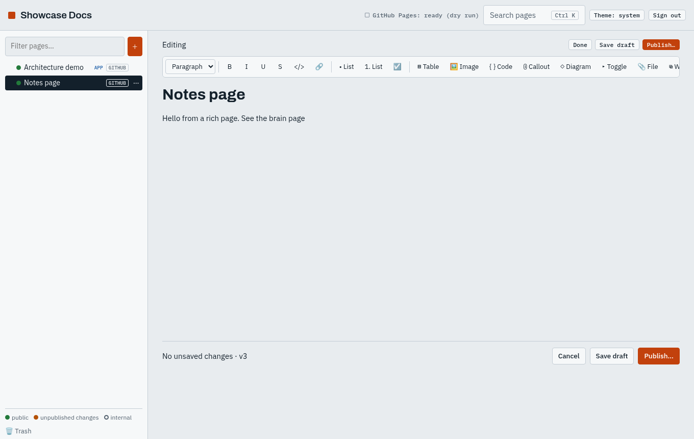
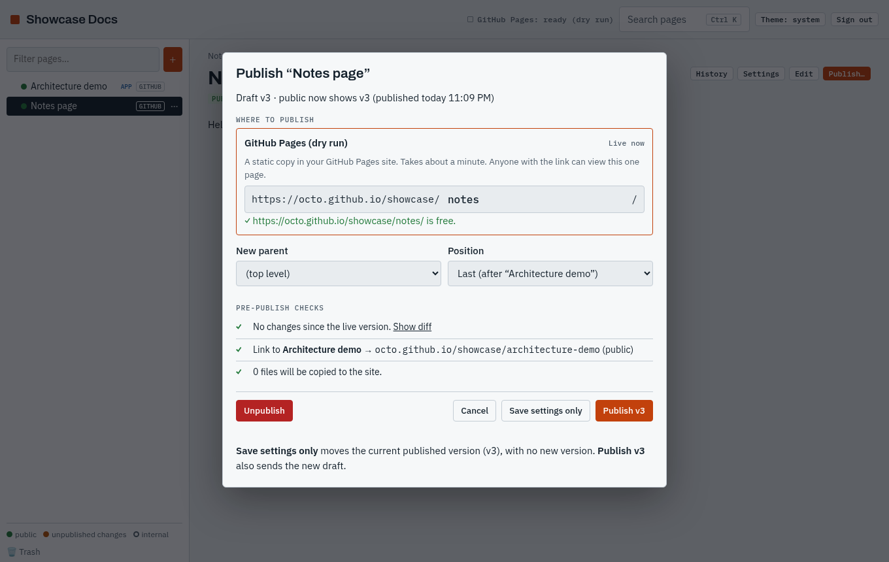
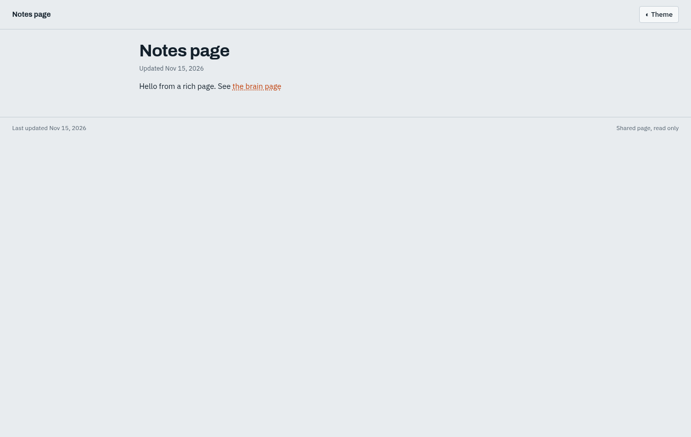

# Showcase Docs

Showcase Docs is a small web editor that you run yourself. You write pages (or upload a small HTML app), and it publishes them as static pages to your own GitHub Pages repository.
There is one admin, protected by a password. The editor stays on your machine, and the only public copy of a page is the one on GitHub Pages.
It has a page tree, a rich editor with images and attachments, version history with restore, a trash, and a preview.

## Quick start

You need Docker with Compose, and a GitHub account.

1. **Create a repository** on GitHub, for example `octo/showcase`. It can be empty, but make one first commit in it (a README is enough). Everything the app publishes is public, so use a repository you are happy to show.
2. **Create a fine-grained token** (GitHub, Settings, Developer settings, Personal access tokens, Fine-grained tokens). Limit it to that one repository and give it these permissions: **Contents: read and write**, **Pages: read**. Copy the token once.
3. **Copy the settings file:**
   ```
   cp .env.example .env
   ```
4. **Make the password hash.** Build the image, then run the hash command and type your password:
   ```
   docker compose build
   docker run --rm -it showcase-docs:local hash-password
   ```
   Paste the output into `.env` as `DOCS_PASSWORD_HASH`, and **double every `$`** (write `$$`), because Compose reads `$` in `.env` as a variable.
5. **Fill in the GitHub settings** in `.env`: `DOCS_GH_ENABLED=true`, `DOCS_GH_REPO=octo/showcase`, `DOCS_GH_TOKEN=<your token>`. The branch defaults to `gh-pages`.
6. **Start it:**
   ```
   docker compose up -d --build
   ```
7. **Open the editor** at `http://localhost:3020` and sign in.
8. **Publish a page.** Create a page, write something, press Publish, choose a folder name, and publish. The top bar shows the GitHub status. Wait until it says the site is live.
9. **Turn on GitHub Pages once.** The branch only exists after the first publish. In the repository go to Settings, Pages, choose "Deploy from a branch", pick `gh-pages` and `/ (root)`, and save. Your page is then at `https://octo.github.io/showcase/<folder>/`.

If you set a custom domain on the repository, set `DOCS_GH_SITE_URL` to it so the links in the editor are right.

## How publishing works

- The app owns one branch (`gh-pages` by default). It never touches other branches.
- When you publish, unpublish, rename a folder, or change anything that is public, the app builds the **whole site** and replaces the branch with **one new commit**. There is no history on that branch. Your history lives in the editor, in each page's version list.
- Each published page gets **one folder**: `<folder>/index.html`, `<folder>/page.json`, its files under `<folder>/a/`, and uploaded apps under `<folder>/app/`. The shared viewer is under `viewer/`. A `.nojekyll` file at the root tells GitHub Pages to serve files as they are.
- Saving a draft never changes the public page. Only Publish does, and it publishes a new version.
- Links between pages become real links to the other page's GitHub address. A link to a page that is not public shows as plain text.
- If GitHub is down or the token is wrong, your change is still saved. The top bar shows the error and a **Retry** button, and the app also retries by itself.
- **Safety rule:** if the branch already holds files but has no `.nojekyll` at its root, the app treats it as someone else's and never overwrites it. Use an empty or new branch.

### Dry run

Set `DOCS_GH_DRY_RUN=true` to write the finished site into the data volume (folder `github-dry-run`) and send nothing to GitHub. The token is not needed in this mode. It is a good way to see what would be published.

## Updating

```
git pull
docker compose up -d --build
```

The data volume is kept. The database migrates itself on start.

## Backups

Everything the app keeps is in the `docs-data` volume, mounted at `/data`:

- `docs.db`: pages, versions, settings (SQLite).
- `blobs/`: uploaded images, attachments and app files.
- `backups/`: a consistent copy of the database made every night, the newest 14 kept.
- `github-dry-run/`: only used in dry-run mode.

Back up the whole volume. For example, to make an archive of it:

```
docker run --rm -v showcase-docs_docs-data:/data -v "$PWD":/out busybox tar czf /out/docs-data.tgz -C /data .
```

The volume name starts with your Compose project name (the folder name by default). Check it with `docker volume ls`. The published site itself is on GitHub and can be rebuilt from the data volume at any time with Retry.

## Troubleshooting

The top bar and the Publish dialog show the message from GitHub. Common ones:

| Message | Cause and fix |
| --- | --- |
| **401** | The token is wrong, expired, or was revoked. Make a new one and set `DOCS_GH_TOKEN`. |
| **403** | The token lacks a permission (it needs Contents read and write, Pages read), or GitHub is rate limiting. Check the token's repository and permissions. |
| **404** | `DOCS_GH_REPO` is wrong, or the token cannot see that repository. Check the spelling and the token's repository list. |
| **409** | The repository is empty. Make a first commit in it (a README), then press Retry. |
| "The branch ... already holds other files" | The branch has files and no `.nojekyll`, so the app will not overwrite it. Set `DOCS_GH_BRANCH` to an empty or new branch name. |
| The page URL gives a 404 | GitHub Pages is not enabled yet, or still building. Enable it once under Settings, Pages (see step 9), and wait a minute. |
| "Invalid Host header" | You opened the editor under a name the app does not know. Add the name to `DOCS_ALLOWED_HOSTS`. |
| Sign-in works but you are signed out at once | `DOCS_SECURE_COOKIES=true` while you use plain http. Set it to `false`, or use https. |

The settings are in `.env`. Run `docker compose logs showcase-docs` for the app log. Tokens are never written to the log.

## Limits

- **Public only.** Every published page is world readable. There is no private or password-protected publishing.
- **About a minute.** A change usually shows on the site within a minute, because GitHub Pages has to build after each commit.
- **GitHub's size limits.** A repository should stay small (GitHub advises under 1 GB), a published Pages site is limited to 1 GB, and a single file must be under 100 MB. The app limits an image or attachment to `DOCS_MAX_ASSET_MB` (20 by default) and an uploaded app to `DOCS_MAX_BUNDLE_MB` (25 by default). Because the whole site is rebuilt each time, many large files make each publish slower.
- One admin, one password. There are no accounts.

## Security notes

- **Keep the editor port private.** The editor has no HTTPS of its own. By default the port is published on `127.0.0.1` only (`DOCS_BIND`). If you must reach it from another machine, put it behind a reverse proxy with TLS or a private network, set `DOCS_ALLOWED_HOSTS` to its name, and set `DOCS_SECURE_COOKIES=true`. Never expose it to the open internet without TLS.
- **The token never leaves the server.** It is only sent to the GitHub API, it is hidden from the log and from every API answer, and it is not part of the published site. Keep `.env` out of version control (`.gitignore` already does this) and limit the token to the one repository.
- Login attempts are rate limited, writes need a CSRF token, and the editor refuses requests that name an unknown host.
- Uploaded HTML apps run in a sandboxed frame with a strict content security policy. Only upload apps you trust, because on GitHub Pages they run on the public site.
- The container runs as a non-root user with a read-only file system.

## Local build without Docker

`scripts/build.sh` builds the web bundles, packs them into the jar, runs all tests, and makes `target/showcase-docs.jar`. You need Node 22, JDK 17 or newer, and Maven.

```
DOCS_PASSWORD_HASH='<hash>' DOCS_GH_DRY_RUN=true DOCS_GH_ENABLED=true DOCS_GH_REPO=octo/showcase java -jar target/showcase-docs.jar
```

## Screenshots

The editor:



The Publish dialog:



A published page, as visitors see it:



## Licence

MIT. See [LICENSE](LICENSE).
